# Ability lifecycle

## Design

`Runner.Create` receives a monotonic clock and a transport. Each returned runner privately owns an actor-to-use execution map. A use binds a behavior and frozen context to its actor, behavior, and use identifiers.

```mermaid
stateDiagram-v2
    [*] --> Started: Begin
    Started --> Holding: Hold
    Started --> Ended: Release / Cancel / failure
    Holding --> Ended: Release / Cancel / failure
    Ended --> [*]: execution removed before callbacks; OnEnded attempted
```

The map entry is removed before terminal callbacks run. This prevents a callback that cancels the same use from running its terminal callbacks twice. `Destroy` snapshots pending work and verifies each entry is still current, because an earlier cancellation callback may already have removed another use.

The runner owns execution records. A behavior owns the resources it acquires and should release them in `OnEnded`, including partially acquired resources when startup fails. The example tracks this ownership with `ActiveEffects`.

Clock injection makes elapsed-time tests deterministic. Transport injection allows a game to select its replication mechanism and recipients without coupling lifecycle logic to a particular networking library.

## Contract and limits

- Use trusted internal callers. Network admission, authenticated actor identity, bounded payload validation, cooldowns, and resource limits belong to the integrating server.
- Clock and callbacks must not yield. Start/hold callbacks must not call runner transitions. General callback reentrancy and concurrent scheduling are outside this extracted component's supported usage.
- The context is shallow-frozen. Behavior callbacks, the transport object, and payload tables are trusted references, not deep immutable snapshots.
- IDs are scoped by actor/use. There is no completed-use cache, so the caller must prevent replay when integrating network requests.
- Hold fires once. It does not schedule repeated charge updates.
- Constructor dependency checks assert misuse. Transition and callback failures return `Ok = false`. Missing-state queries return `nil`; missing cancellation is a successful no-op.
- Failure from `OnStart`/`OnHold` attempts `OnEnded` with `Failed`; it does not also call `OnCancel`. A release/cancel callback failure still attempts `OnEnded` and retains the original terminal reason.
- Destruction tries to finish all still-active executions, is idempotent, and rejects future `Begin`. It discards individual transition errors; integrations needing teardown telemetry should report within their owned callbacks.
- No ordering is promised between different executions during destruction.

## Tests

The specification covers lifecycle ordering, duplicate Begin/Hold, captured replication identity, cleanup, recursive terminal cancellation, and cancellation of other uses during destruction. The example also checks interruption, startup callback failure, resource release, and rejection after destruction.

CI runs both programs, Selene, StyLua, and a Rojo model build. These checks exercise the portable runner; multiplayer, latency, and Roblox-specific integration require tests in the consuming game.
